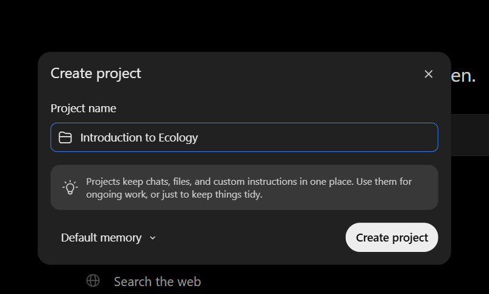
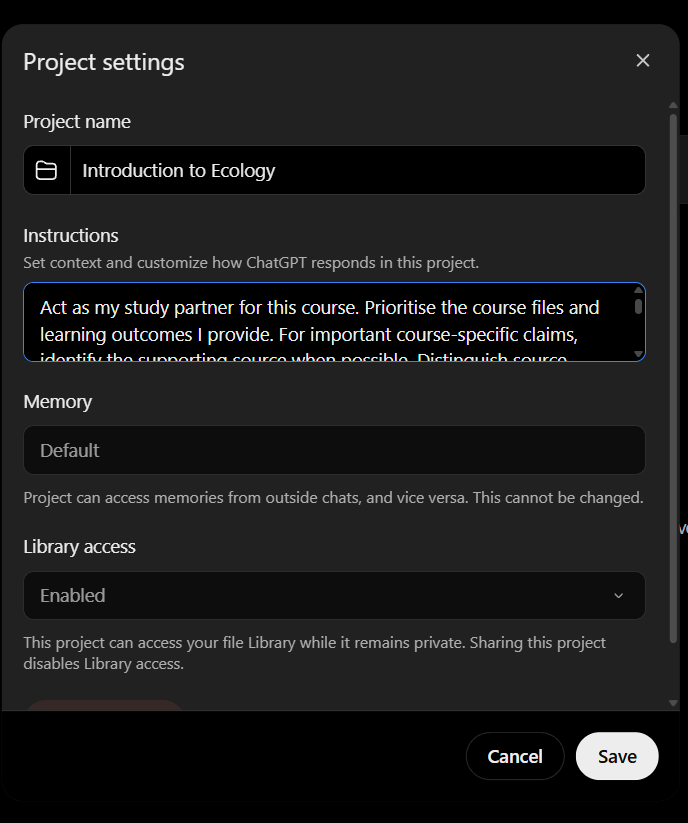

# ChatGPT Projects setup

ChatGPT Projects provide project instructions, files, and conversation context. OpenAI's current Projects documentation does not describe importing a `SKILL.md` as a native Skill, so this guide gives a manual compatibility approach instead. The interface, plans, and limits may change; check the [official Projects in ChatGPT guide](https://help.openai.com/en/articles/10169521-projects-in-chatgpt) for current details.

## Create a project

In the sidebar, hover over **Projects** and select the **+** button. In the **Create project** dialog, enter a course-specific name, then select **Create project**. Project availability can depend on your plan or workspace settings.



## Add project instructions

Open the project and select the **•••** menu in the upper-right corner, then choose **Project settings**. Paste the combined instructions for all three workflows into **Project instructions** as described below. The menu label or location may vary; see the [official Projects guide](https://help.openai.com/en/articles/10169521-projects-in-chatgpt) if your interface differs.



## Add course materials

Open the **Sources** tab and select **Add sources**. Add relevant course files or paste text. Start with learning outcomes and notes for one unit, then add authorised practice questions or an official rubric as needed. Review current file limits and do not upload material you are not permitted to share.

## Add all three StudySuperpowers workflows

OpenAI's current Projects documentation describes Project instructions and sources, not a native `SKILL.md` installer. Use the combined text file once; it adds learn-topic, active-recall, and exam-marker together as Project instructions. This is not native Skill installation and does not provide automatic skill discovery.

1. Download [all ChatGPT Project instructions](https://github.com/keem-sys/StudySuperpowers/releases/latest/download/chatgpt-project-instructions.txt) from the [latest release](https://github.com/keem-sys/StudySuperpowers/releases/latest).
2. Open the `.txt` file, select all, and copy it.
3. Paste the text into your Project's **Project instructions** and save. If the download fails, open [project-instructions.md](project-instructions.md) on GitHub and copy the contents of its text block instead.
4. Add course notes and learning outcomes under the Project's **Sources** tab using **Add sources**. Do not upload the instructions as a source and expect them to activate.
5. Start a new chat and run the [setup verification prompt](../../guides/setup-verification.md). Then ask for the mode you want.

## Start a study workflow

Start a chat within the configured Project and ask for one workflow by name. All three modes remain available; you do not need to replace Project instructions to switch. These prompts are starting points.

```text
Use learn-topic for carrying capacity in my project files. Explain it progressively and ask one comprehension question at a time; wait for my answer.
```

```text
Use active-recall for the learning objectives in Unit 2. Mix recall and application questions, one at a time, and wait for my answer before giving feedback.
```

```text
Use exam-marker on my practice answer below. The question is worth 5 marks, and I have included the official rubric. Identify met and missing criteria, a reasoned suggested mark, and a concise model answer.
```

This is a manual Project-instructions approach for ChatGPT. It does not provide native Skill installation or automatic skill discovery. OpenAI may add or change features, so consult the official Projects guide rather than assuming a native `SKILL.md` mechanism exists.

For unreadable or contradictory sources, see [Troubleshooting](../../guides/troubleshooting.md). For progress summaries and customisation, see [Advanced study setup](../../guides/advanced-usage.md).
