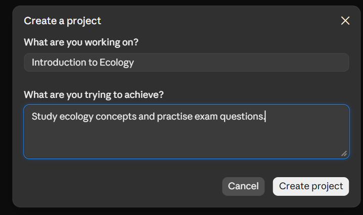
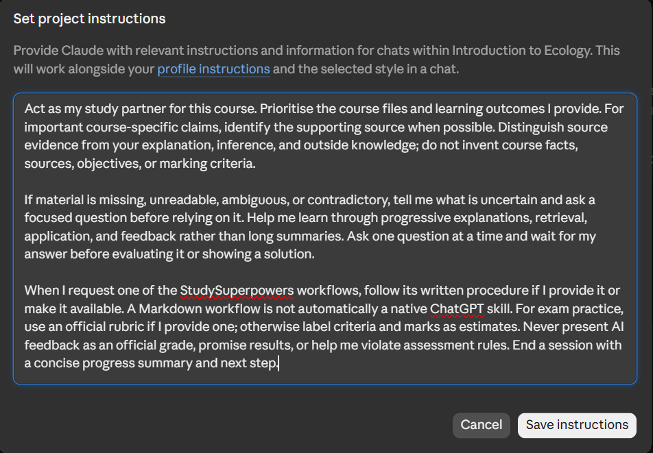
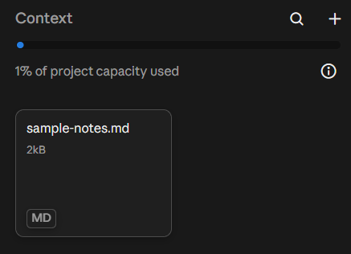

# Claude Projects setup

This guide covers Claude Projects and optional custom Skill uploads. Projects hold course context; Skills provide reusable workflows that Claude can load when relevant. Interfaces, requirements, and availability may change, so check the [official Projects guide](https://support.claude.com/en/articles/9517075-what-are-projects), [project management guide](https://support.claude.com/en/articles/9519177-how-can-i-create-and-manage-projects), and [Skills guide](https://support.claude.com/en/articles/12512180-use-skills-in-claude) for current details.

## Create a project

Open **Projects** from the left side of Claude, then select **+ New Project**. 

Enter a course-specific name and, in **What are you trying to achieve?**, a brief description such as “Study ecology concepts and practise exam questions.” Claude's project guide notes that it does not use the name or description as chat context, so add study guidance under project instructions and upload course materials separately. The current help page describes Projects as available to all users, with a maximum of five projects for free accounts; check current availability and limits in your account.



## Add project instructions

On the project page, select the **+** beside **Instructions**, paste the content of [project-instructions.md](project-instructions.md) into the instruction editor, and save. If the control or save step differs in your account, consult the official guide.



## Add course materials

On the project page, select the **+** beside **Context** to add relevant documents, text, or code. Start with learning outcomes and notes for one unit. Add only materials you are authorised to share. Supported file types and limits may vary by account.



## Install a workflow as a Claude Skill

Claude supports custom Skills uploaded as ZIP files. This is optional: you can still use a workflow manually by providing its instructions in a project conversation. A Skill supplies the workflow; your project **Context** supplies course materials.

Claude requires **Code execution and file creation** to be enabled for Skills. On individual accounts, check **Settings > Capabilities**. On Team or Enterprise accounts, an administrator may need to enable Skills and code execution in organization settings. Availability and controls can vary; see Anthropic's [current Skills instructions](https://support.claude.com/en/articles/12512180-use-skills-in-claude).

Download the ZIP for the workflow you want:

- [Learn a topic](https://github.com/keem-sys/StudySuperpowers/releases/latest/download/learn-topic.zip)
- [Active recall](https://github.com/keem-sys/StudySuperpowers/releases/latest/download/active-recall.zip)
- [Exam marker](https://github.com/keem-sys/StudySuperpowers/releases/latest/download/exam-marker.zip)

Then open [Customize > Skills](https://claude.ai/customize/skills), select **+ > Add > Upload a skill**, choose the ZIP, and enable the Skill. Repeat only for workflows you want. No repository download, folder search, terminal, or manual ZIP creation is needed. Keep course notes in the Project's **Context**; then start a project chat and ask Claude to use the workflow, for example: “Use learn-topic to explain carrying capacity from my project materials.”

Review a Skill before enabling it. The current StudySuperpowers workflows contain Markdown instructions only; if a downloaded Skill includes scripts or other files, inspect those too. Custom Skills are uploaded to an individual Claude account; organization sharing depends on plan and administrator settings.

### Project alternative for accounts without Skills

If Skills are unavailable or disabled for your account, use the copy-ready Project instructions instead. Download one file, open it, copy all its text, and paste it beside **Instructions** in your Claude Project. This is a Project setup alternative, not native Skill installation. Keep your lecture notes under **Context**.

- [Learn a topic Project instructions](https://github.com/keem-sys/StudySuperpowers/releases/latest/download/claude-project-learn-topic.txt)
- [Active recall Project instructions](https://github.com/keem-sys/StudySuperpowers/releases/latest/download/claude-project-active-recall.txt)
- [Exam marker Project instructions](https://github.com/keem-sys/StudySuperpowers/releases/latest/download/claude-project-exam-marker.txt)

These files are attached to GitHub Releases by automation. If the download links are not live yet, the first release has not been published.

## Start a study workflow

If you installed and enabled a StudySuperpowers Skill, ask for the workflow by name; Claude may also select enabled Skills automatically when relevant. The prompts below are starting points.

```text
Use learn-topic for carrying capacity in my uploaded notes. Explain it progressively and ask one comprehension question at a time; wait for my answer.
```

```text
Use active-recall for the learning objectives in Unit 2. Mix recall and application questions, one at a time, and wait for my answer before giving feedback.
```

```text
Use exam-marker on my practice answer below. The question is worth 5 marks, and I have included the official rubric. Identify met and missing criteria, a reasoned suggested mark, and a concise model answer.
```

## Missing, conflicting, or unreadable material

Ask Claude to identify which source it used and what it could not read. If sources disagree, provide the course version or instructor guidance that should take precedence. Do not let it silently reconcile conflicting course materials; pause assessment of the disputed point until clarified.

## Save and reuse progress

At the end of a conversation, request a concise progress summary using the fields in the [quick-start guide](../../guides/quick-start.md#reuse-progress-between-conversations). Review it, then keep it in a separate course note you are comfortable uploading or paste it into the next conversation. The availability of project knowledge and chat history depends on current Claude features and settings; do not rely on a summary being automatically carried into a new conversation.