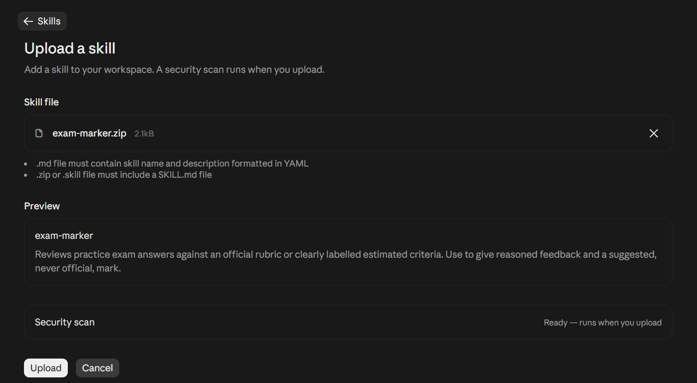

# Claude Projects setup

This guide covers Claude Projects and optional custom Skill uploads. Projects hold course context; Skills provide reusable workflows that Claude can load when relevant. Interfaces, requirements, and availability may change, so check the [official Projects guide](https://support.claude.com/en/articles/9517075-what-are-projects), [project management guide](https://support.claude.com/en/articles/9519177-how-can-i-create-and-manage-projects), and [Skills guide](https://support.claude.com/en/articles/12512180-use-skills-in-claude) for current details.

## Path A: Start studying (recommended)

This path sets up all three workflows together. You do not need to install separate Skills or replace instructions when switching study modes.

1. **Create a course Project.** Open **Projects** and select **+ New Project**. Enter a course name, such as “Introduction to Ecology”; the description is optional and is not used as chat context. Select **Create project**.


2. **Add the combined instructions.** Open the Project. Select **+** beside **Instructions**. Download the [combined Claude Project instructions](https://github.com/keem-sys/StudySuperpowers/releases/latest/download/claude-project-instructions.txt), open the text file, copy its contents, paste them into the instruction editor, and save. One file covers learn-topic, active-recall, and exam-marker.


	**If the download is not available yet:** The repository has no published release at present. Open [project-instructions.md](project-instructions.md) on GitHub and copy the text inside its code block into the Project's **Instructions** field.

3. **Add course materials.** Select **+** beside **Context** and add learning outcomes and notes for one unit. Add only materials you are allowed to share. Begin with a small set, such as the fictional [sample ecology notes](../../examples/sample-course/sample-notes.md), and confirm Claude can read them.


4. **Verify the setup.** Open the [setup verification prompt](../../guides/setup-verification.md), copy it into a new Project chat, and send it. The prompt asks Claude to report which sources it can access without claiming to have read inaccessible files.

5. **Start a session.** In the same Project, ask for one mode, for example: “Use learn-topic to explain carrying capacity from my notes. Ask me one comprehension question, then wait.” You can ask for active-recall or exam-marker in another chat without changing Project instructions.

For unreadable files or other setup issues, see [Troubleshooting](../../guides/troubleshooting.md). For progress summaries and customisation, see [Advanced study setup](../../guides/advanced-usage.md).

## Path B: Install native Claude Skills (optional)

A native Skill is reusable workflow instruction that Claude can load when relevant. Your Claude Project still supplies the course materials. You can install one or more Skills; this is separate from adding Project instructions.

Claude's custom Skills require **Code execution and file creation**. On individual accounts, check **Settings > Capabilities**. On Team or Enterprise accounts, an administrator may control access. If the Skills option is unavailable, use Path A instead; StudySuperpowers cannot detect account eligibility. Check Anthropic's [current Skills instructions](https://support.claude.com/en/articles/12512180-use-skills-in-claude).

Download a ZIP for each Skill you want:

- [Learn a topic Skill](https://github.com/keem-sys/StudySuperpowers/releases/latest/download/learn-topic.zip)
- [Active recall Skill](https://github.com/keem-sys/StudySuperpowers/releases/latest/download/active-recall.zip)
- [Exam marker Skill](https://github.com/keem-sys/StudySuperpowers/releases/latest/download/exam-marker.zip)

In Claude, open [Customize > Skills](https://claude.ai/customize/skills), select **+ > Create skill > Upload a skill**, choose the ZIP, and enable the Skill in your Skills list. Then add course notes to your Claude Project's **Context** and ask for the workflow by name. If your menu labels differ, use Anthropic's linked instructions.



Review a Skill before enabling it. These StudySuperpowers packages contain Markdown instructions only. Custom Skills are uploaded to an individual account; organization sharing depends on plan and administrator settings. For accounts without Skills access, return to Path A.

These ZIP links become active when the first release is published. If they are not available, use Path A to start with the combined Project instructions.

## Start a study workflow

If you used Path A, ask for one workflow by name; all three are available in the same Project. If you installed a native Skill, ask for it by name or describe the task. Examples:

```text
Use learn-topic for carrying capacity in my uploaded notes. Explain it progressively and ask one comprehension question at a time; wait for my answer.
```

```text
Use active-recall for the learning objectives in Unit 2. Mix recall and application questions, one at a time, and wait for my answer before giving feedback.
```

```text
Use exam-marker on my practice answer below. The question is worth 5 marks, and I have included the official rubric. Identify met and missing criteria, a reasoned suggested mark, and a concise model answer.
```

For missing, conflicting, or unreadable material, see [Troubleshooting](../../guides/troubleshooting.md). For progress summaries, see [Advanced study setup](../../guides/advanced-usage.md).